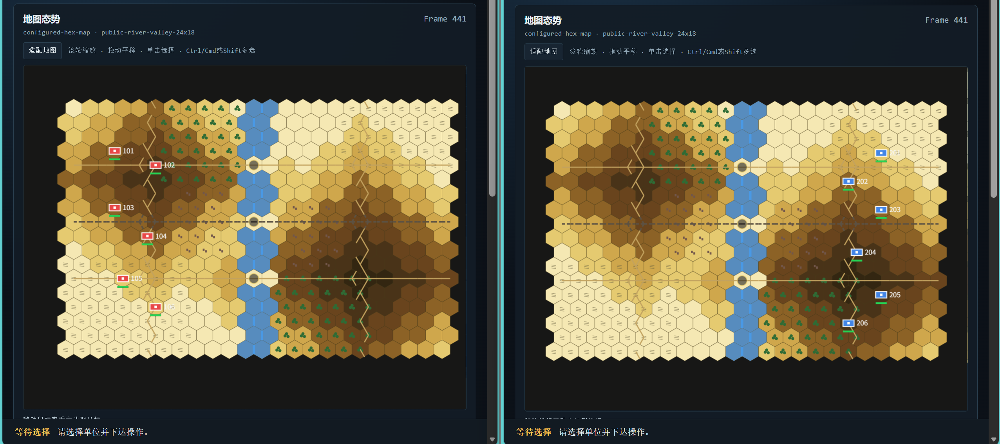

# wargame_native_engine


```text
Human Web / Rule Agent
          |
          v
  Realtime Control
          |
          v
 Joint Adjudication
          |
    +-----+-----+
    v     v     v
   RED   BLUE  GREEN
                |
                v
              Replay
```

`wargame_native_engine` 0.4.0 is an independent, transparent and deterministic
experiment engine. All adjudication is explicitly **Native simplified rules**;
it does not import or claim compatibility with an official SDK, authentication
configuration, binary package, or hidden rules.

It is a server-authoritative, fixed-tick simulation engine with:

* same-pre-state RED/BLUE joint adjudication;
* transactional atomic Tick commit and deterministic `NativeRNG`;
* long-running movement and state transitions advanced by the Engine;
* synchronous training and continuous realtime controller modes;
* detached RED/BLUE observations plus complete referee-only GREEN evidence;
* Human Web, deterministic Random Agent and project-native training adapters;
* state recording and deterministic strict rule replay;
* command/tick/control audit trails and per-frame analysis;
* read-only Web replay viewing and local dual-side control.

## GitHub source release quick start

This release is intended to run from a cloned source tree; it is not yet a
PyPI-stable SDK distribution.

```bash
git clone <repository-url>
cd wargame_native_engine
python -m pip install -e .
```

Start the recommended first-page interactive demo. It uses a committed,
project-authored 24x18 river-valley map with 432 configured hexes, 12 units,
elevation, forests, settlements, soft ground, roads, rivers and three bridge
objectives:

```bash
PYTHONDONTWRITEBYTECODE=1 PYTHONPATH=src \
python -m scripts.run_realtime_dual_control \
  --scenario-bundle=examples/public_river_valley_scenario.json \
  --output-dir=/tmp/wargame-river-valley-web \
  --run-namespace=river-valley-web-000 \
  --tick-interval-ms=1000 --host=127.0.0.1 --port=8003 --overwrite
```

Open the printed RED URL as the operator page and the BLUE URL in a second
tab. Commands are queued without waiting for the other seat while the fixed
authoritative Tick continues movement. `Ctrl+C` publishes the full Replay and
audit package. Selecting one friendly unit also enables the Tactical Awareness
controls: Sensor Coverage is a theoretical unobscured-target observation field,
Weapon Envelope is the theoretical direct-fire area, and yellow outlines are
that selected unit's confirmed contacts. These detached overlays never issue
commands or expose GREEN state. View the published package with the same
terrain map:

```bash
PYTHONDONTWRITEBYTECODE=1 PYTHONPATH=src \
python -m scripts.run_replay_viewer \
  --replay-dir=/tmp/wargame-river-valley-web \
  --map-config=examples/public_river_valley_map.json \
  --port=8000
```

For the smallest one-Tick engine smoke instead, run:

```bash
PYTHONDONTWRITEBYTECODE=1 python examples/run_source_release.py \
  --output /tmp/wargame-native-source-example --seed 42
```

The example loads the committed synthetic Source-compatible scenario, obtains
detached RED and BLUE observations, selects one legal command per side,
advances one joint authoritative tick, writes a GREEN replay, and verifies it
by strict rule re-execution. It needs no private map, old SDK, credentials, or
external service.

Run a deterministic same-tick mutual-fire example through the public product
operation path:

```bash
PYTHONDONTWRITEBYTECODE=1 python examples/run_joint_fire.py \
  --output /tmp/wargame-public-joint-fire --seed 1
```

Both actors are qualified against the same pre-state and are destroyed in one
joint Tick. The generated Replay is strictly re-executed before success is
reported.

## Development workflow

Install the project in editable mode with its development dependencies:

```bash
python -m pip install -e ".[dev]"
```

During development, run the smallest relevant test module or test case, for
example:

```bash
PYTHONDONTWRITEBYTECODE=1 pytest -p no:cacheprovider \
  tests/test_joint_tick_semantics.py -q
```

Before submitting a change, run the complete Python suite and check the diff
for whitespace errors:

```bash
PYTHONDONTWRITEBYTECODE=1 pytest -p no:cacheprovider -q
git diff --check
```

Keep generated runs under ignored `local_data/` paths or `/tmp`, and review
`AGENTS.md` plus `CONTRIBUTING.md` before changing adjudication, replay, or
side-observation behavior. Node.js is optional for Engine development; when it
is unavailable, the static browser JavaScript contract tests are skipped.

## Demo showcase

### 1. Realtime Human Control

The close-combat public fixture keeps the 24x18 terrain presentation while
placing six RED and six BLUE units at six-to-eight-hex contact distances. It
is designed to make MOVE, weapon state, and direct fire easy to demonstrate:

```bash
PYTHONDONTWRITEBYTECODE=1 PYTHONPATH=src \
python -m scripts.run_realtime_dual_control \
  --scenario-bundle=examples/public_close_combat_scenario.json \
  --output-dir=/tmp/wargame-close-combat-web \
  --run-namespace=close-combat-web-000 \
  --tick-interval-ms=1000 --host=127.0.0.1 --port=8003 --overwrite
```

Open the printed RED and BLUE URLs. `WEAPON_LOCK` is the Native simplified
rule's stow/secure transition; it does not mean target lock. Use
`WEAPON_UNFOLD` before SHOOT when a weapon profile requires deployment.

### 2. Tactical Rule Agent Simulation

This deterministic, non-random controller consumes only detached side
observations and server-issued product capabilities. It prefers legal SHOOT,
unfolds after contact when needed, and otherwise advances using a server-issued
MOVE endpoint. Both seats run independently over `RealtimeAgentSession`:

```bash
PYTHONDONTWRITEBYTECODE=1 PYTHONPATH=src \
python -m scripts.run_tactical_agent_demo \
  --scenario-bundle=examples/public_close_combat_scenario.json \
  --output-dir=/tmp/wargame-tactical-agent-demo \
  --run-namespace=tactical-agent-demo-000 \
  --seed=42 --tick-interval-ms=100 --max-ticks=8 --overwrite
```

The JSON result reports ticks, accepted/applied commands, observed contacts,
SHOOT operations, and strict Replay verification. This is a transparent rule
showcase, not an RL or tactical-performance claim.

### 3. Replay Viewer

Open either generated package with the matching committed presentation map:

```bash
PYTHONDONTWRITEBYTECODE=1 PYTHONPATH=src \
python -m scripts.run_replay_viewer \
  --replay-dir=/tmp/wargame-tactical-agent-demo \
  --map-config=examples/public_close_combat_map.json \
  --port=8000
```

Then visit `http://127.0.0.1:8000/`. Replay is authoritative GREEN evidence;
frame analysis and the Viewer remain non-authoritative derivatives.

Recommended application entry points are `WargameFacade` for product control,
`NativeMultiSeatEnv` for synchronous deterministic Agent training, and
`RealtimeAgentSession` for fixed-tick asynchronous command collection.
`GameSession.step` and `SessionManager.advance_ms` are trusted core boundaries,
not the first integration tutorial for untrusted clients.

For continuous human control, start the loopback realtime Web adapter:

```bash
PYTHONDONTWRITEBYTECODE=1 PYTHONPATH=src \
python -m scripts.run_realtime_dual_control \
  --scenario-bundle=examples/source_movement_scenario.json \
  --output-dir=/tmp/wargame-realtime-web \
  --run-namespace=local-realtime-web-000 \
  --tick-interval-ms=1000 --host=127.0.0.1 --port=8003 --overwrite
```

Open the printed RED and BLUE URLs in separate tabs. “下达命令” admits a
high-level operation for a future authoritative tick and does not lock the
seat while waiting for its opponent. A missing side contributes an empty
batch, so time and ongoing MOVE state continue. Multiple disjoint actors
submitted by one browser within the same target tick are accumulated; a newer
operation for the same actor replaces that actor's older pending operation.
Paths, targets and weapons are still planned or selected by the server and are
revalidated at apply time. `Ctrl+C` stops admission and atomically publishes
Replay, analysis, command events and tick events under `--output-dir`.

`scripts.run_dual_side_control` remains the synchronous DecisionWindow product
flow for deliberate two-sided decisions. It intentionally locks a seat after
that side submits. The two Web modes are explicit and do not change each
other's orchestration contract.

For a deterministic two-Agent movement/fire smoke, use the same realtime core
and product operations, then inspect the complete package in the replay viewer:

```bash
PYTHONDONTWRITEBYTECODE=1 PYTHONPATH=src python -m scripts.run_realtime_agent_match \
  --scenario-bundle=examples/source_movement_scenario.json \
  --output-dir=/tmp/wargame-random-agents \
  --run-namespace=random-agents-000 --seed=42 \
  --tick-interval-ms=100 --max-ticks=5 \
  --red-agent=random --blue-agent=random --overwrite
PYTHONDONTWRITEBYTECODE=1 python examples/verify_replay.py \
  --scenario-bundle=examples/source_movement_scenario.json \
  --replay=/tmp/wargame-random-agents/replay.zip
PYTHONDONTWRITEBYTECODE=1 PYTHONPATH=src python -m scripts.run_replay_viewer \
  --replay-dir=/tmp/wargame-random-agents \
  --map-config=examples/public_source_movement_map.json \
  --port=8000
```

`random` selects from detached, side-only capabilities but returns a product
`SeatOperation`: MOVE endpoints are replanned by the server and SHOOT is
revalidated at its apply tick. Ongoing MOVE is not resubmitted each tick. The
map renderer interpolates a friendly unit along its current segment using the
recorded progress; an opponent route is never disclosed to enable animation.
Open `http://127.0.0.1:8000/` after the final command. Generated Replay,
analysis, command, Tick, control-audit and summary files remain under `/tmp`;
they are not repository assets.

Public example data and provenance are documented in
`examples/README.md` and `docs/release/PROVENANCE.md`. Map 123 is a bounded
development validation case and is deliberately not required by this source
release.

## Engine semantic contract

One authoritative `WorldState` advances as:

```text
Collect -> Seal -> same-pre-state adjudication -> joint effect resolution
        -> working-state evolution -> atomic commit
```

All actions in one sealed batch are qualified against the same tick-start
state. Direct-fire outcomes are staged, same-target losses are aggregated, and
the working tick is committed only after action handling, ongoing movement,
visibility, and termination all succeed. A core-tick exception preserves the
prior World, NativeRNG state, logical time, and action/event sequences.

Real time is scheduling, not a per-tick chess turn: once MOVE or another
long-running action begins, the Engine advances its duration and interruption
state on later ticks without requiring the controller to resend "continue".
Manual and background clocks call the same simulation transition.

RED and BLUE are detached limited-information projections of the single
authoritative state. GREEN is the complete referee/recorder projection; it is
not passed to side Agents. The renderer and analysis paths are observer-only.

Native replay supports both recorded state frames and deterministic strict
replay. Strict replay re-executes accepted actions through this repository's
Native simplified adjudication and rejects a mismatched adjudication-semantics
version before the first step.

## Run with a versioned ruleset

The default JSON ruleset expands its operator, weapon and terrain profiles into
one canonical ruleset hash. No YAML dependency is required.

```bash
python -m wargame_native_engine.cli.run_game \
  --scenario examples/minimal_scenario.json \
  --ruleset config/rulesets/native_default_v1.json \
  --red-agent first-valid \
  --blue-agent first-valid \
  --seed 42 \
  --output local_data/runs/minimal_v2
```

Run the migrated 3v3 fixture with independent Agent seeds:

```bash
python -m wargame_native_engine.cli.run_game \
  --scenario examples/migrated_scenario_small.json \
  --ruleset config/rulesets/native_default_v1.json \
  --red-agent random-legal \
  --blue-agent random-legal \
  --seed 42 \
  --max-ticks 500 \
  --output local_data/runs/migrated_small
```

A max-tick result is `truncated: true`; it is never reported as a natural win.

## Migrate the reduced legacy-shaped fixture

```bash
python -m wargame_native_engine.cli.import_scenario \
  --source examples/legacy_scenario_reduced_fixture.json \
  --source-identifier legacy-field-structure-small/sanitized-reduced-fixture \
  --ruleset config/rulesets/native_default_v1.json \
  --output local_data/migrations/migrated_small
```

The command emits the native scenario plus manifest, field mapping, unmapped
field list and warnings. It reads legacy JSON as data and never imports the old
project at runtime.

## Evaluate procedural fairness

```bash
python -m wargame_native_engine.cli.evaluate_fairness \
  --scenario examples/migrated_scenario_small.json \
  --ruleset config/rulesets/native_default_v1.json \
  --red-agent random-legal \
  --blue-agent random-legal \
  --seeds 0:99 \
  --swap-sides \
  --mirror \
  --output local_data/fairness/migrated_small
```

Inspect `summary.json` for per-variant results, paired winner consistency,
side-swap outcome reversal, mirror consistency, score/survival/damage
differences, and replay/state mismatch counts. Overall red/blue win rate alone
is not treated as proof of fairness.

## Strict replay

```python
from wargame_native_engine.io.replay import replay_actions
from wargame_native_engine.io.scenario import load_scenario

scenario = load_scenario("examples/minimal_scenario.json")
verification = replay_actions(
    scenario,
    "local_data/runs/minimal_v2",
    ruleset="config/rulesets/native_default_v1.json",
    strict=True,
    seed=42,
)
assert verification.matches
```

Strict replay checks scenario hash, ruleset ID/version/hash and seed before
execution. `strict=False` is explicit and emits a warning on mismatch.

See `docs/RULESET_CONFIGURATION.md`, `docs/SCENARIO_MIGRATION.md`,
`docs/FAIRNESS_VALIDATION.md` and `docs/REPLAY_FORMAT.md`.

## Import and align reduced historical evidence

Only already parsed, legally obtained data is accepted. The committed example
is a small sanitized fixture, not an original official replay.

```bash
python -m wargame_native_engine.cli.import_historical_replay \
  --input examples/historical_replay_reduced_fixture/smoke-state-01 \
  --output local_data/historical_replays/smoke

python -m wargame_native_engine.cli.align_replay \
  --historical-replay local_data/historical_replays/smoke/historical_replay.json \
  --ruleset config/rulesets/native_default_v1.json \
  --output local_data/alignment/smoke
```

The importer labels evidence as `ACTION_LEVEL`, `STATE_TRAJECTORY_LEVEL`,
`EVENT_LEVEL`, or `SUMMARY_ONLY`. Only action-level evidence can drive Native
adjudication. Unknown Action Echo never becomes an inferred action.

## Calibrate bounded Native parameters

```bash
python -m wargame_native_engine.cli.calibrate_rules \
  --split config/calibration/replay_split_v1.json \
  --baseline-ruleset config/rulesets/native_default_v1.json \
  --parameter-space config/calibration/parameter_space_v1.json \
  --output local_data/calibration/native_v1

python -m wargame_native_engine.cli.evaluate_calibrated_rules \
  --split config/calibration/replay_split_v1.json \
  --ruleset local_data/calibration/native_v1/calibrated_ruleset.json \
  --partition validation \
  --output local_data/calibration/native_v1/validation
```

Search uses only the calibration partition. Validation is loaded after a fixed
candidate is selected. The baseline is never overwritten, and small samples
produce an explicit evidence limitation rather than an official-equivalence
claim. See `docs/HISTORICAL_REPLAY_IMPORT.md`, `docs/REPLAY_ALIGNMENT.md`, and
`docs/RULE_CALIBRATION.md`.

## Source-frame compatibility and direct fire

The standard frame is a data compatibility contract, not a hidden rule source:

```bash
python -m wargame_native_engine.cli.inspect_source_frame \
  --input local_data/source_frames/96.json \
  --output local_data/source_frames/96_report
```

The only executable direct-fire source is
`config/adjudication/source_tables_v1/native_adjudication_tables_final.json`.
Its schema, revision, file hash, and canonical content hash are verified before
lookup. No PDF is read at runtime and no interpolation is available.

```bash
python -m wargame_native_engine.cli.resolve_direct_fire \
  --scenario examples/direct_fire_scenario.json \
  --attacker 101 --target 201 --weapon 9101 --seed 42 \
  --output local_data/adjudication/direct_fire_smoke
```

The output is a strict `native-direct-fire-replay/1.0` bundle. Target `202`
exercises the vehicle and armor-correction path.

```bash
python -m wargame_native_engine.cli.run_source_compatible_game \
  --frame local_data/source_frames/96.json \
  --ruleset config/rulesets/native_default_v1.json \
  --table-set config/adjudication/source_tables_v1/manifest.json \
  --max-events 20 \
  --output local_data/runs/source_frame_smoke
```

See `docs/SOURCE_FRAME_COMPATIBILITY.md`, `docs/SOURCE_VISIBILITY.md`, and
`docs/DIRECT_FIRE_ADJUDICATION.md`.

## Source-compatible movement

Phase 4A.2 routes ordered Move, Shoot, StopMove and transition actions through
the same `GameSession -> NativeEngine.step` call. Integer delta-time advances
explicit hex-path segments, timers, observation and valid actions. The small
fixture is `examples/source_movement_scenario.json`; semantics and field units
are documented in `docs/SOURCE_MOVEMENT.md`.

## RED, BLUE, GREEN and production Source replay

`setup_views()` and `step_views()` return RED and BLUE isolated controller
frames plus the complete GREEN referee frame. Production recording stores only
numbered GREEN frames and the shared strict step records.

```bash
python scripts/run_minimal_source_replay.py \
  --output local_data/acceptance/source_perspectives_smoke \
  --seed 42
```

The smoke moves, changes visibility, resolves direct fire, packages
`replay.zip`, imports it through the historical-compatible reader, strictly
replays its steps, and compares final hashes. See
`docs/SOURCE_PERSPECTIVES.md`, `docs/SOURCE_REPLAY_RECORDER.md`, and
`docs/MINIMAL_END_TO_END_ACCEPTANCE.md`.

## Documentation and license

Start with `docs/architecture/source_release.md` for public/internal boundaries,
`docs/architecture/public_api.md` for product control, `examples/README.md` for
public fixture provenance, and `CONTRIBUTING.md` for release regression gates.
Replay details are in `docs/REPLAY_FORMAT.md` and
`docs/SOURCE_REPLAY_RECORDER.md`.

Project source is released under the MIT License in `LICENSE`. Before making a
public repository, the owner should complete the rule-guide/table redistribution
confirmation recorded in `docs/release/PROVENANCE.md`.
