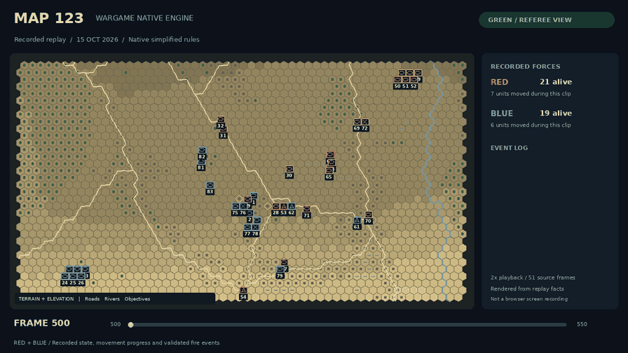

# Wargame Native Engine

用于兵棋推演、浏览器交互和智能体训练的独立 Python 引擎。当前版本为
**0.4.4**，采用 **Native 简化规则**，不代表官方 SDK 或官方裁决行为。

引擎以固定 Tick 推进，在同一前置状态下处理红蓝双方意图；世界状态由服务端统一维护。
支持移动、直射与间接火力、上下车、隐蔽、无人机和巡飞弹等动作，具体可用动作取决于
场景、单位能力和当前状态。支持红蓝受限视角、GREEN 裁判记录、确定性回放及训练接口。

## Map123 双方行动演示

[](assets/map123-500-550.mp4)

[观看 MP4 视频](assets/map123-500-550.mp4) · [静态预览](assets/map123-500-550-poster.png)

片段取自 2026 年 10 月 15 日录制的 Map123 回放，包含第 **500～550 帧**，共 51 帧，
按 2 倍速呈现，时长 **25.5 秒**。采用 GREEN 裁判全局视角，展示红蓝双方移动以及
已通过校验的射击事件；被拒绝的请求单独标注，不作为已执行攻击展示。
这是根据真实回放事实渲染的态势动画，不是浏览器录屏，也不是训练策略效果证明。
下方默认启动公开河谷场景；Map123 的完整发布数据和启动入口也已包含，见“地图数据与启动”。

## 目录

```text
src/wargame_native_engine/   引擎、裁决、控制、训练适配与 Web 界面
config/                     运行规则、映射、Schema 和训练配置
docs/rules/                 引擎初始化校验所需的两份规则来源
scripts/                    Web、回放与训练接入启动入口
examples/                   公开场景与地图
examples/map123/            Map123 场景、移动表和压缩视线数据
examples/maps/              地图目录清单与功能示例场景
assets/                     Map123 展示视频、动图预览和封面
pyproject.toml              安装配置与依赖
LICENSE                     MIT 许可证
README.md                   总体说明、启动方法与训练接口
```

这是面向源码运行的发布目录。请保留上述目录关系，并在仓库根目录执行命令。
运行配置和地图是引擎所需资料，应与源码一起使用。
`docs/rules/` 中的两份规则文本是引擎初始化校验所需的来源资料，必须保留。

## 安装

需要 Python 3.10 或更高版本。基础引擎无第三方运行依赖；项目内 PPO 学习器需要
可选的 PyTorch 依赖。

```bash
git clone git@github.com:XiangquanTang/wargame-native-engine.git
cd wargame-native-engine
python -m venv .venv
source .venv/bin/activate
python -m pip install -e .
```

Windows 可使用 `.venv\Scripts\activate` 激活环境。以下命令中的 `python` 均指当前虚拟环境。

## 启动浏览器推演

```bash
python -m scripts.run_realtime_dual_control \
  --scenario-bundle examples/public_river_valley_scenario.json \
  --output-dir local_data/river-valley-web \
  --run-namespace river-valley-web-001 \
  --tick-interval-ms 1000 \
  --host 127.0.0.1 --port 8003
```

打开终端输出的 RED 和 BLUE 地址，分别进入红方和蓝方操作页。该公开示例使用
24×18 六角地图和 12 个单位。选择己方单位后，根据界面显示的当前能力提交操作。

引擎持续推进，指令提交成功不表示动作已经完成。移动、上下车等持续动作由后续 Tick
推进，调用方应读取后续己方观察与动作状态。运行至少一个 Tick 后，使用 Ctrl+C 停止并发布回放、分析和控制记录。
输出目录应使用新的路径；只有明确需要覆盖旧结果时才传入 `--overwrite`。

## 地图数据与启动

本版收录 **18 项地图资源、19 个场景变体**。完整文件路径、字节数、SHA-256、地图身份、
场景身份和初始单位数见 [地图数据目录](examples/maps/catalog.json)。所有地图和场景内容
沿用现有公开示例的原始文件字节；功能示例仅收录运行所需的场景数据。

| 地图入口 ID | 用途 | 已配置六角格数 |
| --- | --- | ---: |
| `map123` | 完整 Map123；原始场景与 12 门炮各 2 发弹药的演示变体 | 10000 |
| `river-valley` | 公开河谷，含道路、河流、桥梁与目标点 | 432 |
| `close-combat` | 公开近战；与河谷共用地形布局，保留独立地图和场景身份 | 432 |
| `source-movement` | 基础移动与外部训练接入 | 6 |
| `boarding` | 上下车 | 2 |
| `concealment` | 隐蔽 | 3 |
| `direct-fire` | 直射火力 | 2 |
| `drone` | 无人机 | 4 |
| `guided-fire` | 引导火力 | 24 |
| `indirect-fire` | 间接火力 | 2 |
| `loitering-munition` | 巡飞弹 | 4 |
| `loitering-expiry` | 巡飞弹生命周期 | 2 |
| `mechanized-assault` | 机械化突击 | 3 |
| `objective-control` | 目标点控制 | 3 |
| `visibility` | 视线与遮挡 | 21 |
| `operation-lifecycle` | 持续动作 | 8 |
| `combined-arms` | 合成作战 | 11 |
| `joint-fire` | 同 Tick 联合火力 | 2 |

功能示例可能只配置少量相邻格；地图声明的宽高或行列范围不表示所有格都可执行移动。
河谷与近战的地形布局相同，表中按各自运行身份分别列出。

查看地图清单并核对全部数据文件与引擎/查看器的地图身份：

```bash
python -m scripts.run_maps list
python -m scripts.run_maps verify
```

通过统一入口启动任一地图，例如：

```bash
python -m scripts.run_maps run close-combat --port 8003
python -m scripts.run_maps run combined-arms --port 8003
```

每次启动会生成新的运行目录，终端打印 RED、BLUE 操作页地址。`run` 后的端口、时间间隔、
输出目录等参数交给原有 Web 启动器处理。上面两条启动命令应分别运行，结束一场后再启动下一场。

### Map123 数据包

Map123 使用 **100×100 六角格、200 米格尺度**。场景中的地图宽高为 20000 米，
不能将这两个物理尺寸误解成六角格的行列数。

| 文件 | 内容 |
| --- | --- |
| `examples/map123/scenario.json` | 原始转换后的 Native 场景，含权威地形和 49 个初始单位 |
| `examples/map123/scenario-artillery-ammo2.json` | 独立标注的炮兵演示变体，不改写原场景 |
| `examples/map123/movement_costs.native.json` | Native 规范移动代价表，约 3.05 MiB |
| `examples/map123/123see.npz` | 原始压缩静态视线数据，约 21.3 MiB |
| `examples/map123/map_runtime_manifest.native.json` | 地图身份、网格、查表模式、尺寸和内容校验信息 |

首次使用前可以单独准备缓存：

```bash
python -m scripts.run_map123 --prepare-only --scenario artillery-ammo2
```

该命令校验压缩源和移动表，流式展开视线数据，并验证运行时地图身份。展开后的
`visibility.native.npy` 为 **1,000,000,128 字节**，通过只读内存映射使用；请为本地缓存
留出约 1.1 GB 磁盘空间。缓存写入 `local_data/map123/runtime-cache/`，后续启动校验后复用。
展开数据、缓存锁、推演结果和回放不属于 Git 上传内容。缓存准备目前按 Linux 环境验证。

启动视频对应的炮兵演示场景，或切换到原始场景：

```bash
python -m scripts.run_maps run map123 --variant artillery-ammo2 --port 8003
python -m scripts.run_maps run map123 --variant original --port 8003
```

分别执行其中一条即可；`run` 会自动准备或复用缓存。新启动是一场新对局，不会自动重现
上方视频中的人工操作序列。Map123 运行结果默认保存在 `local_data/map123/runs/`。

场景中的 `map` 是引擎的地形输入，`public_*_map.json` 是独立展示数据。Map123 还必须
配合上述移动与视线资源；从代码接入时，先使用 `prepare_map_runtime_data(...)` 得到缓存，
再将其作为 `map_runtime_data` 传入 `ScenarioMatchFactory.from_path(...)`，保持地图身份一致。

## 查看回放

```bash
python -m scripts.run_replay_viewer \
  --replay-dir local_data/river-valley-web \
  --map-config examples/public_river_valley_map.json \
  --scenario-config examples/public_river_valley_scenario.json \
  --port 8000
```

打开终端给出的地址。回放查看器只读取结果，不参与引擎裁决。

## 训练接口

| 接口 | 用途 |
| --- | --- |
| `ScenarioMatchFactory.from_path(...)` | 从场景构建对局，声明地图、存储目录和时间间隔 |
| `NativeMultiSeatEnv` | 外部算法控制红蓝双方，每次联合提交推进一个决策窗口 |
| `SingleSeatTrainingAdapter` | 在双席位环境外组合一个外部对手，向算法暴露单席位接口 |
| `NativeTrainingEnv` | 编码后的单席位环境，供项目内学习器接入 |
| `NativeMaskedPPO` / `NativePPORunner` | 项目内带动作掩码的 PPO、采样、更新、存档和评估 |

这些训练入口最终都调用同一条 `GameSession -> NativeEngine.step` 裁决路径。
`NativeMultiSeatEnv` 提供双方采样和控制能力；双策略优化或自博弈调度需要调用方实现。
当前默认 PPO v1 路径使用 CPU 和配置中指定的固定 NoOp 对手。

### 外部算法接入示例

```python
from pathlib import Path

from wargame_native_engine.agents import SeatDecision
from wargame_native_engine.operations import ScenarioMatchFactory
from wargame_native_engine.training import NativeMultiSeatEnv

factory = ScenarioMatchFactory.from_path(
    Path("examples/source_movement_scenario.json"),
    storage_root=Path("local_data/external-training/storage"),
    red_controller_id="external-red",
    blue_controller_id="external-blue",
    decision_interval_ms=2000,
    frame_interval_ms=1000,
)
env = NativeMultiSeatEnv(
    factory,
    run_namespace="external-training-001",
    max_decision_windows=10,
)
try:
    initial = env.reset(seed=42)
    for _ in range(10):
        red_context = env.decision_context("red")
        blue_context = env.decision_context("blue")
        # 在此用各自的受限观察调用策略，并生成当前窗口的 SeatDecision。
        # 空决策表示等待，便于先接通环境；这段示例不执行策略优化。
        result = env.step(SeatDecision(), SeatDecision())
        # result.rewards 按红蓝双方区分。
        if result.terminated or result.truncated:
            break
finally:
    env.close()
```

单席位编码环境使用 `reset(seed)`、`current_decision_binding()` 和
`step_bound_action(action_index, binding)` 完成交互；动作索引只能用于产生它的当前
观察、动作目录和掩码。过期的目录不能用于后续决策。

RED、BLUE 只能接收各自的脱离世界状态的受限观察；训练策略不得读取 GREEN 裁判帧、
对方合法动作、隐藏属性或 RNG。一个训练 step 对应一个决策窗口，可以包含多个引擎 Tick。
`terminated` 表示引擎终局，`truncated` 表示训练或运行边界截断，两者应分别处理。

### 项目内 PPO 启动入口

安装可选学习器依赖：

```bash
python -m pip install -e ".[learner]"
```

运行一次有边界的训练、checkpoint 保存和独立进程评估示例：

```bash
python -m scripts.run_training_roundtrip run \
  --output local_data/ppo-run-001 \
  --updates 1 --evaluation-episodes 1
```

该入口用于演示训练生命周期，默认总时限为 300 秒，不代表策略已经学会作战。
训练超参数位于 `config/training/`；正式实验应另行指定训练预算、场景、奖励和评估方案。
checkpoint 包含配置、场景和状态身份，恢复时必须匹配；评估不更新策略参数。
可通过 `python -m scripts.run_training_roundtrip --help` 查看子命令。

## 运行结果与规则边界

回放包可包含 `replay.zip`、`frame_analysis.native.jsonl`、控制审计、实时 Tick 记录和摘要。
训练结果还可包含决策转移、奖励记录和 checkpoint。运行结果保存在 `local_data/` 下，
不属于源码发布内容。

固定输入、配置和种子用于复现实验。GREEN 保存完整裁判证据；分析、训练适配器和
查看器不拥有第二套裁决逻辑。所有战斗结果均应解释为当前配置下的 Native 简化规则结果。

许可证见 [LICENSE](LICENSE)。
