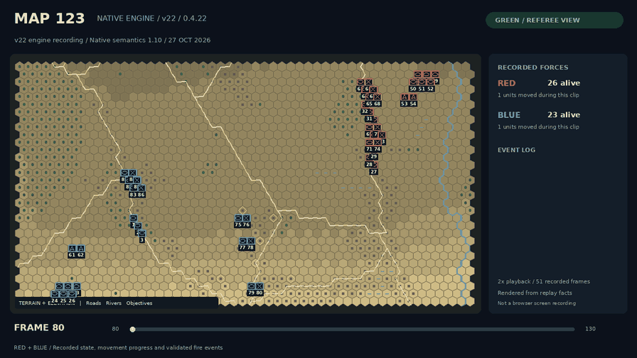

# Wargame Native Engine · v22

**软件版本 0.4.22；裁决语义 `native-joint-prestate/1.10`（沿用 v21）。**
独立 Python 兵棋游戏引擎：统一服务端裁决、红蓝受限观察、浏览器操作、模型接入和确定性回放。
本版整理源码与启动输出，不另建一套游戏规则。采用 Native 简化规则，不宣称与旧平台完全等价。

## v22 实跑演示

[](assets/map123-v22.mp4)

[观看 MP4](assets/map123-v22.mp4) · [行动画面](assets/map123-v22-poster.png) · [地图总览](assets/map123-v22-overview.png)

素材由 **0.4.22 / native-joint-prestate/1.10** 引擎新录制的 Map123 对局生成，
展示双方武器锁定就绪后的移动和位置射击。截取第 80～130 帧，2 倍速、25.5 秒，
GREEN 裁判视角，红蓝双方同屏。位置射击不推断隐含目标或伤害。
图片和视频是对真实回放事实的渲染，不是浏览器界面截图，也不表示策略已学会作战。
回放已通过严格重执行校验；素材哈希和来源见 [provenance.json](assets/provenance.json)。

## 安装与快速启动

需要 Python 3.10+。基础运行无第三方 Python 依赖。在完整源码根目录执行：

```bash
python -m pip install -e .
python -m scripts.run_maps list
python -m scripts.run_maps run river-valley --port 8003
```

打开终端给出的 RED / BLUE 地址。默认只监听 `127.0.0.1`；云端按已有 Notebook 代理方式访问，
见 [云端操作](docs/notebook_map123.md)。运行后按 Ctrl+C 停止并保存回放。不要直接关闭进程来代替正常保存。

## 上传地图和想定，开始新对局

每张地图保留自己的 ZIP，与对应想定 JSON **分别放入** `local_data/maps/inbox/`，不用压成总包。
下列文件由使用者自行提供，不随公开源码包分发。在项目根目录分别执行其中一条：

```bash
PYTHONPATH=src:. python -m scripts.run_maps start --input local_data/maps/inbox/map_221.zip --scenario-input local_data/maps/inbox/2201010101.json
```

```bash
PYTHONPATH=src:. python -m scripts.run_maps start --input local_data/maps/inbox/map_9601.zip --scenario-input local_data/maps/inbox/201033029601.json
```

- 只转换和检查：追加 `--prepare-only`。
- 需要机器可读的详细准备报告：追加 `--json`；默认使用简明加载摘要。
- 两个服务同时运行：第二个追加 `--port 8004`。端口占用不是地图错误，不要反复解析来解决。
- 每次 `start` 新建场景和对局目录；不覆盖输入和旧复盘。
- 地图 ZIP 需包含 `basic.json`、`cost.pickle` 与唯一 `*see.npz`。加载契约与兼容参数见
  [地图工作区](docs/multi_map_workspace.md) 和 [想定转换](docs/source_game_start_v17.md)。

运行日志区分“准备完成”与“服务启动成功”，打印实际数据路径和运行入口。
内容校验哈希仍用于缓存、地图身份、动作新鲜度与严格回放，默认不再把整份身份 JSON 倾倒到控制台。
详细身份保留在准备/运行记录中，不要手动删改。

## Map123 与公开功能场景

```bash
python -m scripts.run_maps verify
python -m scripts.run_maps run map123 --variant original --port 8003
```

公开地图清单见 [catalog.json](examples/maps/catalog.json)。Map123 使用 100×100 格、每格 200 米；
首次展开视线缓存需约 1.1 GB 磁盘空间，后续复用经过校验的缓存。
`--variant artillery-ammo2` 为独立炮兵演示，不修改原始想定。

## 五个逻辑模块

| 模块 | 主要目录 | 职责 |
| --- | --- | --- |
| 游戏主要逻辑 | `core/`、`adjudication/`、`movement/`、`visibility/`、`rules/` | 权威状态、机动、视线、射击和其他裁决 |
| 操作功能 | `operations/`、`gateway/`、`session/`、`agents/realtime.py` | 席位、预检、提交、持续动作、固定 Tick 生命周期 |
| 模型接口 | `agents/`、`training/`、`observations/`、`llm_input/` | 受限观察、工具调用、绑定动作和训练接入 |
| 加载数据接口 | `data/`、`io/`、`compat/`、`config/` | 地图/想定转换、规则来源、运行表和一致性校验 |
| 渲染前端 | `viewer/`、`rendering/`、`projection/` | 浏览器显示、交互、区域覆盖与回放视图 |

上表为职责分组，不是强行移动所有 Python 模块：既有导入路径保留，避免破坏模型和脚本接入。
[架构与数据流](docs/architecture.md) 说明横向支持模块、数据契约及运行边界。

## 源码与开发资料分离

```text
src/ scripts/ config/ examples/   运行代码、入口、配置与公开数据
docs/rules/                     运行所需规则来源，不能删除
docs/                           当前接口、规则和维护文档
benchmarks/manifests/            可选 Agent 评估入口配置
checks/ devtools/                本地完整源码保留；GitHub 精简发布不包含
local_data/                     用户输入、缓存、运行结果（本机生成，不提交仓库）
```

请保留完整源码目录关系；本项目不是只复制 `src/` 就能运行的独立 wheel。
旧发布流水账已从新交付目录移除，现行规则和接口说明仍保留。升级与数据迁移见
[v22 迁移说明](docs/v22_migration.md)。

## 模型接口与验证

- [游戏工具接口](docs/game_tool_calling.md)：受限查询 → 预检 → 提交 → 结果查询。
- [工程导读](docs/engineering_guide.md)：`ScenarioMatchFactory`、`RealtimeAgentSession` 与训练边界。
- [地图结构化接口](docs/map_structuring.md)、[训练接口说明](docs/training_validation.md)。
- [武器锁定与姿态](docs/weapon_lock_workflow_v20.md)、[射击高差与区域覆盖](docs/fire_elevation_units.md)。

完整源码压缩包中的 `checks/` 和 `devtools/` 已保留在本地，供开发时运行；GitHub 精简版主要提供运行代码、公开数据、模型接口和使用资料。

Node.js 用于前端逻辑测试；可选 PPO 学习器另需 `pip install -e '.[learner]'`，正常游戏不需要。
测试通过表示已覆盖用例通过，不等于保证不存在任何缺陷；浏览器实机验证与接口测试应分别记录。
发布验证结果以本次交付证据为准，不把旧版测试数字冒充 v22 结果。

许可证：[MIT](LICENSE)。
