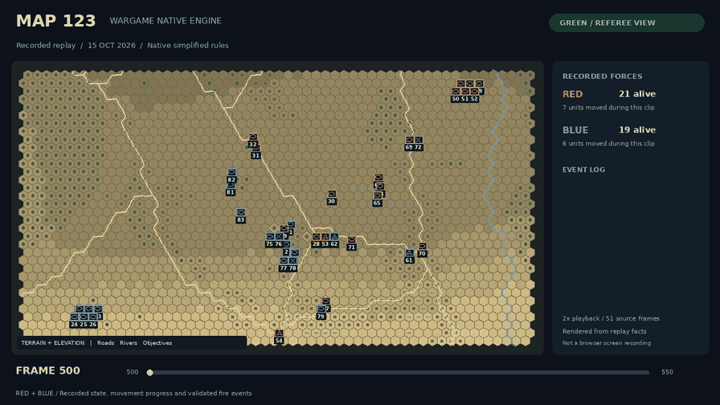

# Native Wargame · 长程决策与临机决策

面向 **RL、规则控制器与 LLM + Jev** 的可审计简化兵棋引擎。项目重点研究模型如何在连续对抗中制定长程计划、落实当前行动，并随态势变化调整决策。当前引擎版本为 **0.4.24.1**，支持独立决策样本、片段导出与确定性复盘。

欢迎交流兵棋智能体、长程规划、临机决策、模型接入与联合评估。可以通过 [GitHub Issues](https://github.com/XiangquanTang/wargame-native-engine/issues) 联系我，介绍你的研究方向、应用场景或合作想法。

## 对局展示

[](assets/map123-500-550.mp4)

Map123 历史对局（2026-10-15），第 **500～550 帧**，红蓝同屏，2 倍速、25.5 秒。画面由真实回放数据渲染，用于展示引擎推演与复盘。

[观看视频](assets/map123-500-550.mp4) · [查看封面图](assets/map123-500-550-poster.png) · [素材来源](assets/provenance.json)

## 主要评估什么

| 方向 | 重点观察 |
| --- | --- |
| **长程决策** | 目标分解、兵力与资源安排、多阶段行动衔接，以及计划在连续决策窗口中的执行与调整。 |
| **临机决策** | 遭遇敌情、目标变化或行动受阻时，能否结合当前可见态势及时选择合理的合法动作。 |
| **计划与行动衔接** | 战略意图是否体现在具体行动中；局部动作是否支持阶段目标；何时需要重新规划。 |

评估结合完整对局和关键片段，关注目标进展、资源消耗、应变过程与最终结果。决策记录保留当时的可见态势、战略计划、完整候选、模型选择及执行反馈，便于逐步核对模型为什么这样行动。

## 两条对战入口

| 对战 | 红方 | 蓝方 |
| --- | --- | --- |
| **RL 对战规则** | 冻结 PPO | 规则控制器 |
| **LLM + Jev 对战 RL** | 冻结 PPO | Qwen 战略计划 + NanoJev 合法动作选择 |

Qwen 负责战略规划，默认每 30 个仿真秒或重要事件触发重规划；NanoJev 将战略意图与当前可见态势结合，从引擎提供的合法候选中选择动作。

两个入口共用 `scripts.run_match`，每个决策窗口每方最多提交一条命令，候选上限为 255。模型调用出错时默认停止，便于定位与核对。

## 启动示例

Python **3.10+**，在仓库根目录执行。核心引擎使用标准库，PPO 运行需要 PyTorch。按运行环境安装开发包：

```bash
python -m pip install -e '.[dev]'
```

对战入口读取 `release_assets/` 下配置的地图、想定和 PPO 权重。本地模型路径与服务启动方式见[模型服务说明](docs/local_model_services.md)。

**RL 对战规则：**

```bash
# 20 步短局
python release_assets/run_workflow.py rl-vs-rules --max-steps 20

# 1500 步对局
python release_assets/run_workflow.py rl-vs-rules --max-steps 1500
```

**LLM + Jev 对战 RL：**

保持 Qwen 服务（`127.0.0.1:8766`）与 NanoJev 服务（`127.0.0.1:8765`）运行，然后启动：

```bash
# 20 步短局
python release_assets/run_workflow.py llm-jev-vs-rl --max-steps 20

# 1500 步对局
python release_assets/run_workflow.py llm-jev-vs-rl --max-steps 1500
```

每次运行会创建独立的 `local_data/matches/` 子目录，保存对局与决策记录。`--max-steps` 是运行上限；达到上限时，`winner: null` 表示没有胜方裁决。

自定义地图、权重路径、模型服务地址和重规划间隔，可查看入口参数：

```bash
PYTHONPATH=src:. python -m scripts.run_rl_rules_match --help
PYTHONPATH=src:. python -m scripts.run_llm_jev_match --help
```

## 地图123交互演示

仓库包含地图123原生想定、压缩通视数据与移动代价。首次准备会生成约 1.1 GB 的本地缓存，保存在 `local_data/`。

```bash
PYTHONPATH=src:. python -m scripts.run_map123 --prepare-only
PYTHONPATH=src:. python -m scripts.run_map123 --port 8003
```

## 决策记录与复盘

每条决策样本包含该方当前可见态势、完整战略计划、局部编号与完整候选动作、选择及执行反馈。片段可以独立阅读，适合分析长程计划的落实过程，以及关键窗口的临机选择。

```bash
# 将“本局目录”替换为实际运行生成的目录
PYTHONPATH=src:. python -m scripts.inspect_decisions \
  --input local_data/matches/本局目录/decisions.jsonl \
  --side blue --limit 20

# 导出第100～120窗口的蓝方决策片段
PYTHONPATH=src:. python -m scripts.inspect_decisions \
  --input local_data/matches/本局目录/decisions.jsonl \
  --side blue --start-window 100 --end-window 120 \
  --output local_data/datasets/blue-100-120.jsonl
```

模型输入使用该方可见信息，执行结果与后续状态单列。制作训练样本时，应将执行后信息与观察者数据留作标签或评估信息。确定性引擎重放使用原生复盘包。

## 文档与交流

- [决策样本、查看与片段导出](docs/self_contained_decisions.md)
- [本地 Qwen / NanoJev 服务](docs/local_model_services.md)
- [模型与训练接入](docs/engineering_guide.md)
- [引擎架构与数据流](docs/architecture.md)
- [版本验证记录](VALIDATION.json)
- [联系作者 / 讨论合作](https://github.com/XiangquanTang/wargame-native-engine/issues)

代码采用 [MIT 许可证](LICENSE)。地图与模型等数据资产按各自授权使用。
